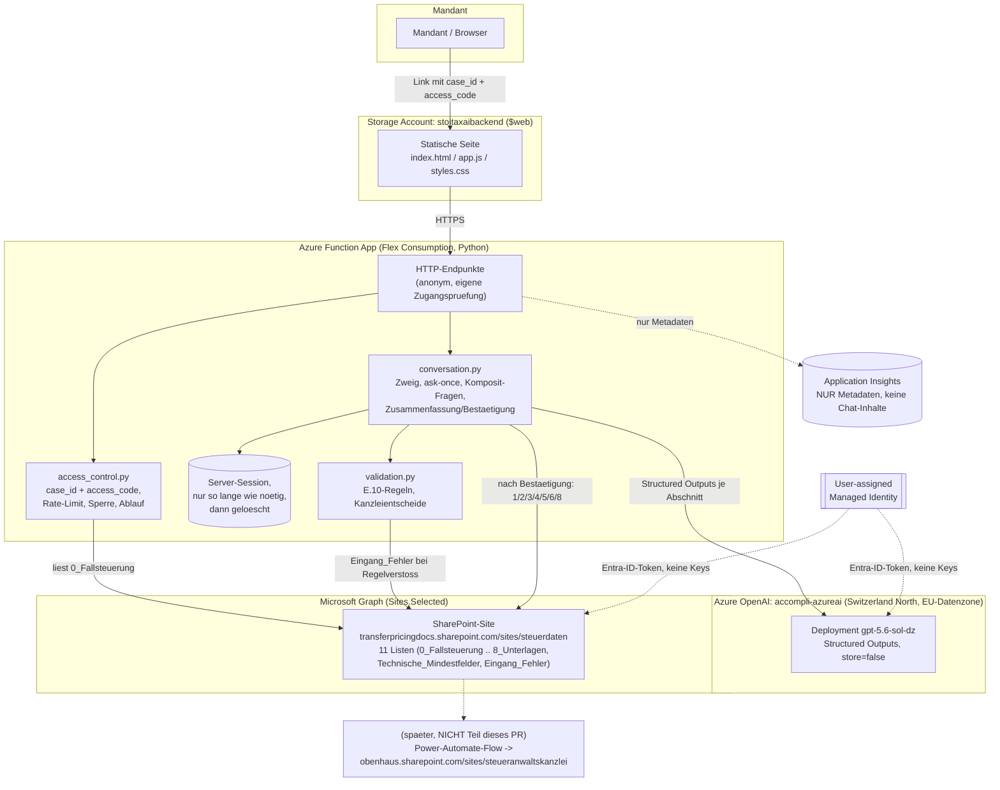
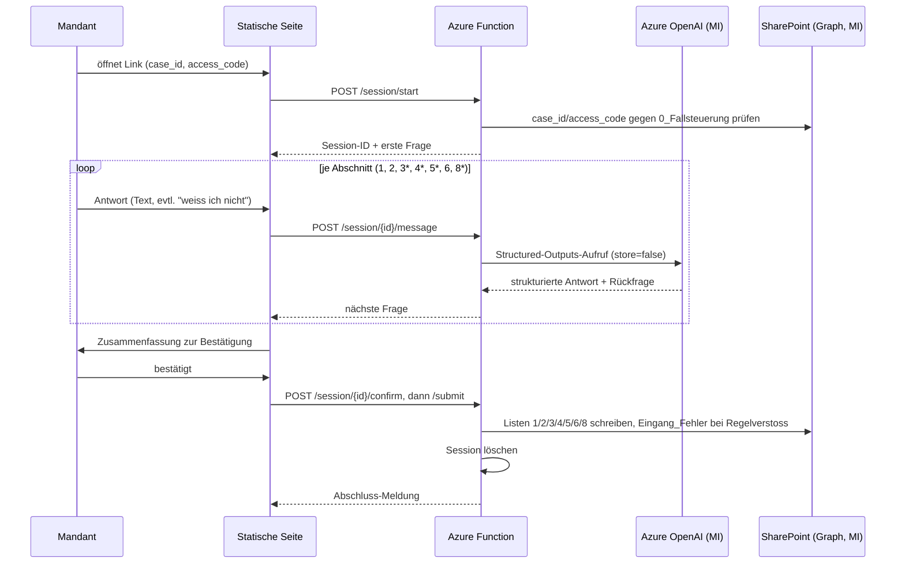

# Erfassungs-Chat (Prototyp) – geführte steuerliche Erfassung für Mandanten

**Status: Prototyp. Noch nicht deployt, noch nicht gegen echte Azure- oder
SharePoint-Ressourcen getestet. Ausschliesslich Testdaten verwenden, bis
Microsoft die beantragte „Modified Abuse Monitoring“-Ausnahme für
`accompli-azureai` bewilligt hat (siehe Abschnitt „Datenschutz“ unten). Bis
dahin KEINE echten Mandatsdaten in dieses System eingeben – weder in Tests
mit echten Azure-Ressourcen noch im Betrieb.**

Ersetzt/ergänzt die Microsoft-Forms-basierte steuerliche Erfassung
DE/AO (siehe [`../sharepoint-forms/`](../sharepoint-forms/)) durch einen
geführten Chat: verständliche Sprache, Rückfragen bei Unklarem, akzeptiert
„weiss ich nicht“, validiert, zeigt vor dem Absenden eine Zusammenfassung zur
Bestätigung und schreibt erst danach strukturiert in die SharePoint-Listen.

**Erster Anwendungsfall:** steuerliche Erfassung einer ausländischen
Gesellschaft in Deutschland (Formulartyp „Körperschaft nach ausländischem
Recht“ aus dem Datenmodell, siehe
[`../Einheitliches-Datenmodell-steuerliche-Erfassung-DE-Auslandsbezug.md`](../Einheitliches-Datenmodell-steuerliche-Erfassung-DE-Auslandsbezug.md)
Abschnitt 9).

## Inhaltsverzeichnis

1. [Designprinzip: Tatsachen statt Würdigung](#designprinzip-tatsachen-statt-würdigung)
2. [Architektur](#architektur)
3. [Schema-Generator statt Abschrift](#schema-generator-statt-abschrift)
4. [Scope des ersten Anwendungsfalls](#scope-des-ersten-anwendungsfalls)
5. [Datenschutz](#datenschutz)
6. [Lokal testen](#lokal-testen)
7. [Deploy-Schritte (jede Ressource einzeln)](#deploy-schritte-jede-ressource-einzeln)
8. [Kosten pro Erfassung (grobe Schätzung)](#kosten-pro-erfassung-grobe-schätzung)
9. [Verzeichnisstruktur](#verzeichnisstruktur)
10. [Was ist gebaut, was ist offen](#was-ist-gebaut-was-ist-offen)

## Designprinzip: Tatsachen statt Würdigung

**Vorgabe Nils Obenhaus:** Der Chat erhebt ausschliesslich
Anknüpfungstatsachen, nie eine steuerliche Würdigung. Er fragt den Mandanten
nie nach einem Ergebnis, das die Kanzlei erst beurteilen muss – zum Beispiel
nicht nach dem zuständigen Finanzamt, Soll- oder Ist-Versteuerung,
Kleinunternehmerregelung, BZSt-Zielmeldung, Organschaft oder „ist das eine
Betriebsstätte?“. Stattdessen fragt er die Tatsachen ab, aus denen die
Kanzlei das beurteilt: Sitz, Ort der Geschäftsleitung (indirekt über den
üblichen Arbeitsort der Geschäftsführer), Tätigkeit und Räumlichkeiten in
Deutschland, Umsätze/Gewinn (Vorjahr bzw. erwartet), Beteiligte und deren
Wohnsitz, Buchführungs-/Bilanzierungspflicht, Handelsregistereintragung usw.
Ergebnisfelder bleiben im Chat leer – sie sind für die Kanzlei reserviert.
Optional darf der Chat einen Vorschlag als **intern markierten Hinweis**
ablegen, **nie als Mandantenangabe**.

Weitere Einzelregeln, die daraus folgen (alle unten technisch umgesetzt):

- Kontaktdaten (E-Mail, Telefon, Ansprechpartner) werden nicht erfragt – die
  liegen im CRM der Kanzlei.
- Stammangaben (Firmenname, Rechtsform) werden genau einmal erfragt.
- Die Fragefolge verzweigt nach Art des Meldepflichtigen (natürliche Person
  vs. Gesellschaft) und fragt jede Information nur einmal.
- Rechtsform wird zweistufig erhoben: erst Grundtyp (Einzelunternehmen,
  Freiberufler, Personengesellschaft, Kapitalgesellschaft), dann deutsches
  oder ausländisches Recht; bei ausländischem Recht Wortlaut + Staat.
- Tätigkeit wird offen erfragt; bei Hinweis auf Vermögensverwaltung folgt
  eine Anschlussfrage nach Anteil an Umsatz/Gewinn – nie direkt
  „ausschliesslich vermögensverwaltend?“.
- Ort der Geschäftsleitung wird nie direkt erfragt, sondern über den
  üblichen Arbeitsort der Geschäftsführer und etwaige weitere Arbeitsorte.
- Wirtschaftsjahr: erst „entspricht dem Kalenderjahr?“, nur bei „Nein“
  Beginn.
- Vorgänger: „Wurde die Tätigkeit vorher ganz oder teilweise von jemand
  anderem ausgeübt?“ statt einer rechtlich vorgeprägten Gründungsart-Frage.
- Gewinnermittlungsart wird nicht erfragt – stattdessen die Tatsachen
  (Umsatz/Gewinn erwartet, Buchführungs-/Bilanzierungspflicht nach
  ausländischem Recht, bereits bilanziert, Handelsregistereintragung).
- Zu jeder Frage kann der Mandant „Was ist damit gemeint?“ auswählen und
  bekommt eine Erklärung in einfacher Sprache.

### Wie das technisch durchgesetzt wird

Zweistufig, damit es nicht bei einer Dokumentations-Konvention bleibt:

1. **Generator** ([`generator/field_classification.py`](generator/field_classification.py),
   [`generator/build_llm_schemas.py`](generator/build_llm_schemas.py)): jedes
   Feld aus dem PnP-Skript wird klassifiziert als `tatsache`, `ergebnis`
   (rechtliche Würdigung/Prognose der Kanzlei) oder `system`
   (technisch bzw. Kontaktdaten im CRM). **Nur `tatsache`-Felder landen
   überhaupt im Azure-OpenAI-Schema** – ein Ergebnisfeld kann technisch gar
   nicht erfragt werden, weil es nie Teil der Structured-Outputs-Definition
   ist. Ein Regressionstest
   ([`generator/tests/test_build_llm_schemas.py::test_ergebnis_fields_never_in_any_chat_schema`](generator/tests/test_build_llm_schemas.py))
   prüft das explizit gegen die von Nils genannten Beispiele.
2. **Backend** ([`backend/app/conversation.py`](backend/app/conversation.py)):
   Felder, bei denen schon die direkte Frage die Würdigung vorwegnähme (z. B.
   „ist der Ort der Geschäftsleitung abweichend?“), sind zusätzlich als
   `_COMPOSITE_ONLY_FIELDS` aus der generischen Abschnittsfrage
   ausgeschlossen und werden stattdessen über dedizierte Methoden erhoben und
   zusammengesetzt (`submit_legal_form`, `submit_business_activity` +
   `submit_vermoegensverwaltung_anteile`, `submit_wirtschaftsjahr`,
   `submit_geschaeftsfuehrer_arbeitsort`).

### Ein paralleler PR baut die eigentliche Grundlage – dieser Generator ist darauf vorbereitet

Ein anderer Agent baut parallel ins Datenmodell/PnP-Skript ein: die
Grundregel selbst, eine Ableitungstabelle Ergebnisfeld → Tatsachenfelder und
ein `applies_to`-Metadatum je Feld. Bis dahin ist die Klassifizierung hier
eine **von Hand gepflegte, versionierte Konfigurationstabelle**
([`generator/classification_config.json`](generator/classification_config.json),
169 Felder über die sieben vom Chat genutzten Listen, jede mit kurzer
Begründung).

Der Generator ist bewusst zweistufig gebaut
([`generator/field_classification.py`](generator/field_classification.py)):

- `MetadataClassificationProvider` liest `field_role`/`applies_to` **direkt
  vom Katalogeintrag**, sobald der parallele PR diese Attribute über das
  PnP-Skript/den Parser liefert – heute liefert er für jedes Feld `None`
  zurück (Metadaten existieren noch nicht), das ist der gewünschte Zustand.
- `ConfigClassificationProvider` ist der Übergangszustand (siehe oben).
- `CompositeClassificationProvider` fragt zuerst die Metadaten, dann die
  Konfiguration, und **wirft einen Fehler**, wenn beide ein Feld nicht
  kennen (Fail-Closed: ein neues Feld nach einem Merge wird nie
  unklassifiziert als Tatsache durchgereicht, sondern bricht den
  Generator-Lauf sichtbar ab, bis es eingetragen ist).

**Sobald der parallele PR gemerged ist:** nur `MetadataClassificationProvider`
in `field_classification.py` an das tatsächliche Attribut/die tatsächliche
Spalte anpassen (siehe Kommentar dort, „Erwartetes Metadaten-Format“) – der
Rest des Generators, die Tests und `classification_config.json` als
dauerhaftes Fallback bleiben unverändert. Das ist genau die in der Aufgabe
verlangte Vorbereitung: „konfigurierbare Ausschluss- bzw. Zweigtabelle bis
dahin, danach automatisch aus den Metadaten“.

## Architektur



### Ablauf einer Erfassung (Sequenz)



## Schema-Generator statt Abschrift

> Grundlage: [`../sharepoint-forms/New-SteuerlicheErfassungListen.ps1`](../sharepoint-forms/New-SteuerlicheErfassungListen.ps1)
> (Soll-Schema, 217 Felder über 11 Listen).

Ein paralleler PR eines anderen Agents ändert gerade `0_Fallsteuerung` (u. a.
`access_code` automatisch, `registration_status` Ja/Nein/Unbekannt statt
Boolean, `tax_office_country` als Choice und optional, sprechende Werte für
`direction`). Damit dieser Chat nach dem Merge **automatisch** nachgezogen
werden kann, wird das Schema nie von Hand abgeschrieben, sondern per
Generator abgeleitet:

```text
DE/AO/erfassungs-chat/generator/
├── pnp_schema_parser.py        PnP-Skript -> Feldkatalog (217 Felder, 11 Listen)
├── field_classification.py     Tatsache/Ergebnis/System + Zweig (siehe oben)
├── classification_config.json  Uebergangs-Konfigurationstabelle (169 Felder)
├── build_llm_schemas.py        Feldkatalog + Klassifizierung -> Structured-Outputs-Schema je Liste
├── cli.py                      `python3 -m generator.cli build` -> generator/output/
└── tests/                      35 Tests, u. a. gegen das ECHTE Skript im Repo
```

Nach jedem Merge, der das PnP-Skript ändert:

```bash
cd DE/AO/erfassungs-chat
python3 -m generator.cli build
python3 -m unittest discover -s generator/tests -t .
```

`generator/output/` enthält danach den aktuellen Katalog, je Liste ein
Azure-OpenAI-Structured-Outputs-Schema, die Feld-Metadaten für das Backend
und zwei Transparenzberichte:

- `classification_report.json`: welche Felder je Liste enthalten bzw.
  ausgeschlossen wurden, mit Begründung.
- `required_ergebnis_konflikte.json`: **ein konkreter, automatisch
  erkannter offener Punkt** – SharePoint-Spalten, die als Ergebnisfeld vom
  Chat ausgeschlossen sind, aber im PnP-Skript weiterhin `-Required` sind
  (aktuell `tax_office`, `formation_type`, `profit_determination_method`,
  `site_type`). Siehe Abschnitt „Was ist offen“ unten.

Die Einschränkungen für Azure-OpenAI-Structured-Outputs sind im Generator
hart codiert und werden getestet: höchstens 100 Properties und 5 Ebenen pro
Schema (jede der sieben Listen bleibt unter 30 Properties), alle Felder
`required` mit Nullbarkeit über Union mit `null`, kein `pattern`/`format`.

## Scope des ersten Anwendungsfalls

Der Chat bedient **sieben** der elf Listen: `1_Allgemeiner_Stammblock`,
`2_Unternehmens_Gruendungsmodul`, `3_Personen_und_Vertretung`,
`4_Beteiligte_und_Quoten`, `5_Betriebsstaetten`,
`6_Steuer_und_Umsatzsteuerprofil`, `8_Unterlagen`. `0_Fallsteuerung` bleibt
kanzleiintern (der Fall wird dort vor dem Chat-Link angelegt, inkl.
`case_id`/`access_code`), `7_Auslandsmitteilung_BZSt2` ist Outbound-spezifisch
und nicht Teil des ersten Anwendungsfalls.

Gegenüber der reinen ELSTER-Formular-Routingtabelle
([`../sharepoint-forms/README.md`](../sharepoint-forms/README.md) Abschnitt
E.9, die für „Körperschaft nach ausländischem Recht“ nur 1/3/5/8 vorsieht)
wurden **2, 4 und 6 bewusst ergänzt**, weil Nils Obenhaus zusätzliche
Tatsachen verlangt (Gründung/Wirtschaftsjahr, Beteiligte/Wohnsitz,
Umsätze/Beschäftigte), die im Datenmodell, aber nicht im amtlichen
ELSTER-Formular stehen (siehe `generator/cli.py`, `CHAT_LISTS`).

**Kanzleientscheide** (siehe
[`backend/app/validation.py::evaluate_legal_form_decision`](backend/app/validation.py)):

- Vereine, Stiftungen und juristische Personen des öffentlichen Rechts sind
  ausgeschlossen – der Chat lehnt diese Fälle direkt bei der
  Rechtsform-Frage ab und legt einen internen Hinweis für die Kanzlei ab.
- Personengesellschaften, LLP und LLC nach ausländischem Recht gehen in die
  manuelle Prüfung – der Fall wird markiert (interner Hinweis an
  `0_Fallsteuerung.processing_note`), **nicht abgelehnt**, und läuft normal
  weiter.
- Das Mitteilungsjahr (Liste 7, für den ersten Anwendungsfall nicht
  genutzt) ist im Generator weiterhin als Zahl 1000–9999 modelliert.

## Datenschutz

- **Berufsgeheimnis nach § 203 StGB.** Dieses System verarbeitet potenziell
  mandatsbezogene Daten über eine Cloud-KI – deshalb:
- **Bis Microsoft die beantragte „Modified Abuse Monitoring“-Ausnahme für
  `accompli-azureai` bewilligt hat, dürfen in dieses System AUSSCHLIESSLICH
  Testdaten eingegeben werden** – keine echten Mandatsdaten, auch nicht in
  einem Testlauf gegen echte Azure-/SharePoint-Ressourcen. Alle
  Testfälle/Szenarien in diesem Repo (siehe `backend/mocks/`,
  `backend/tests/test_scenario_foreign_ltd.py`) sind frei erfunden.
- `store=false` bei jedem Azure-OpenAI-Aufruf (siehe
  [`backend/app/llm_client.py`](backend/app/llm_client.py)).
- Keine Chat-Inhalte in Logs oder Application Insights – nur Metadaten
  (Listenname, Dauer, Status). `content_filter`-Fehler werden abgefangen und
  dem Mandanten ausschliesslich eine neutrale Meldung angezeigt (siehe
  [`backend/app/errors.py`](backend/app/errors.py)).
- Die Chat-Session wird serverseitig nur so lange gehalten wie nötig und
  nach erfolgreichem Abschluss sofort gelöscht (siehe
  [`backend/app/session_store.py`](backend/app/session_store.py),
  `ConversationEngine.submit()`).
- Zugriff auf SharePoint ausschliesslich über Microsoft Graph mit Managed
  Identity und `Sites.Selected`, beschränkt auf GENAU die eine Site (siehe
  [`infra/graph-sites-selected-setup.md`](infra/graph-sites-selected-setup.md)).
- Datei-Uploads sind auf Größe und Dateityp begrenzt (siehe
  [`backend/app/document_upload.py`](backend/app/document_upload.py)); eine
  **Malware-/Virenprüfung findet aktuell NICHT statt** – siehe „Was ist
  offen“ unten.

## Lokal testen

Kein Azure-Zugang nötig – Mock-Modus für SharePoint (JSON-Dateien) und LLM
(deterministischer Mock) ist Standard.

```bash
cd DE/AO/erfassungs-chat

# 1. Schemas aus dem aktuellen PnP-Skript generieren
python3 -m generator.cli build

# 2. Generator-Tests (35 Tests)
python3 -m unittest discover -s generator/tests -t .

# 3. Backend-Tests (55 Tests, inkl. Testszenario "Nordlicht Trading Ltd.")
python3 -m unittest discover -s backend/tests -t backend
```

Beide Testläufe benötigen nur die Python-Standardbibliothek – `openai`,
`azure-identity`, `requests` aus `backend/requirements.txt` werden im
Backend-Code **lazy importiert** und sind für den Mock-Betrieb nicht
installiert.

**Frontend lokal ansehen:** `frontend/index.html` direkt im Browser öffnen
oder mit einem beliebigen statischen Server ausliefern (z. B.
`python3 -m http.server` im Ordner `frontend/`). Ohne laufende Function App
zeigt der Zugangsschritt einen Verbindungsfehler – für eine echte
Ende-zu-Ende-Demo müsste zusätzlich `func start` (Azure Functions Core
Tools, hier nicht vorinstalliert) mit `ERFASSUNGSCHAT_MOCK_MODE=true`
laufen.

**Azure Functions Core Tools lokal starten** (sofern installiert):

```bash
cd DE/AO/erfassungs-chat/backend
cp local.settings.json.example local.settings.json
pip install -r requirements.txt   # nur noetig fuer den echten Azure-Modus
func start
```

## Deploy-Schritte (jede Ressource einzeln)

**Nicht in dieser Session ausgeführt** – `infra/main.bicep` ist vorbereitet,
aber nicht deployt. Jeder Schritt einzeln, damit Nils Obenhaus jede Position
separat freigeben kann.

| # | Ressource | Zweck | Bicep-Ressource |
|---|---|---|---|
| 1 | Resource Group | Container für alles unten | – (vorher per `az group create`) |
| 2 | User-assigned Managed Identity | einzige Azure-Identität der Function App, keine Keys | `managedIdentity` |
| 3 | Storage Account (Function-Deployment) | Flex-Consumption-Deploymentpaket + Runtime-State | `functionStorageAccount` |
| 4 | Storage Account (`$web`, z. B. `stoitaxaibackend`) | statisches Frontend-Hosting | `staticWebStorageAccount` |
| 5 | Log Analytics Workspace + Application Insights | **nur Metadaten**, Sampling 50 % | `logAnalyticsWorkspace`, `appInsights` |
| 6 | App Service Plan (Flex Consumption) | Hosting-Plan der Function App | `flexConsumptionPlan` |
| 7 | Function App | Backend-Logik, HTTP anonym mit eigener Zugangsprüfung | `functionApp` |
| 8 | Rollenzuweisung „Cognitive Services OpenAI User“ auf `accompli-azureai` | erlaubt der Managed Identity NUR Inferenz-Aufrufe, keine Admin-Rechte | `openAiRoleAssignment` |
| 9 | Microsoft Graph `Sites.Selected` auf `transferpricingdocs.sharepoint.com/sites/steuerdaten` | Zugriff NUR auf diese eine Site | siehe [`infra/graph-sites-selected-setup.md`](infra/graph-sites-selected-setup.md) (dokumentiertes Skript, nicht Teil von Bicep) |
| 10 | Statisches Website-Hosting auf Storage Account #4 aktivieren | `$web`-Container freischalten | manueller Schritt nach Deployment (`az storage blob service-properties update --static-website`, siehe Kommentar in `main.bicep`) |
| 11 | Frontend-Dateien nach `$web` hochladen | eigentliche Seite live schalten | `az storage blob upload-batch` |
| 12 | `New-SteuerlicheErfassungListen.ps1` gegen `steuerdaten` ausführen | die 11 Listen auf der Accompli-Site anlegen | siehe `../sharepoint-forms/README.md` – NICHT Teil dieses PR, eigener Schritt |

```bash
# Rein illustrativ, NICHT ausgefuehrt:
az group create --name rg-erfassungschat-dev --location germanywestcentral
az deployment group create \
  --resource-group rg-erfassungschat-dev \
  --template-file infra/main.bicep \
  --parameters @infra/main.parameters.example.json
```

Die spätere Übertragung geprüfter Fälle von `steuerdaten` (Accompli) nach
`obenhaus.sharepoint.com/sites/steueranwaltskanzlei` per Power-Automate-Flow
ist **nicht Teil dieses PR** und hier nur skizziert (siehe Architektur-Diagramm
oben, Knoten „spaeter“).

## Kosten pro Erfassung (grobe Schätzung)

**Grobe Schätzung, keine verifizierten Preise** – vor Produktivbetrieb mit
der Kanzlei-Finanzverantwortlichen und dem tatsächlichen Preis für das
`gpt-5.6-sol-dz`-Deployment abzugleichen.

| Posten | Annahme | Grobe Kosten je vollständiger Erfassung |
|---|---|---|
| Azure OpenAI (gpt-5.6-sol-dz) | ca. 15–25 Chat-Runden über 7 Abschnitte, wachsender Kontext, ca. 40.000 Input-/8.000 Output-Token insgesamt, Preisniveau GPT-4o-Klasse | ca. 0,25–0,40 EUR |
| Azure Functions (Flex Consumption) | wenige Sekunden Rechenzeit, kleine Zahl Aufrufe | < 0,01 EUR |
| Storage/App Insights | vernachlässigbar pro Einzelfall | < 0,01 EUR |
| **Summe** | | **ca. 0,30–0,50 EUR pro vollständiger Erfassung** |

Der LLM-Anteil dominiert und hängt stark von der tatsächlichen Gesprächslänge
(Rückfragen, „weiss ich nicht“, Korrekturen) sowie dem tatsächlich
abgerechneten Preis des Deployments ab.

## Verzeichnisstruktur

```text
DE/AO/erfassungs-chat/
├── README.md                    diese Datei
├── generator/                   PnP-Skript -> Schema (siehe oben)
├── backend/                     Azure Functions (Python), Mock- und Azure-Modus
│   ├── app/                     Logik ohne azure.functions-Abhaengigkeit (testbar)
│   ├── function_app.py          HTTP-Wrapper (Azure Functions v2)
│   ├── mocks/sharepoint_data/   Mock-SharePoint-Listen (Testdaten)
│   └── tests/                   55 Tests inkl. Testszenario
├── frontend/                    statische Seite (HTML/CSS/Vanilla-JS)
└── infra/                       Bicep + Graph-Setup-Doku (nicht deployt)
```

## Was ist gebaut, was ist offen

**Gebaut und getestet (90 automatisierte Tests, alle grün, siehe oben):**

- Schema-Generator mit Tatsachen/Ergebnis/System-Klassifizierung und
  Zweig-Filterung, lauffähig gegen das echte PnP-Skript.
- Zugangsprüfung (case_id/access_code, Rate-Limit, Sperre nach
  Fehlversuchen, Linkablauf).
- Serverseitige Session mit TTL und Löschung nach Abschluss.
- Mock-SharePoint- und Mock-LLM-Client, austauschbar gegen echte
  Azure-Implementierungen über Umgebungsvariablen.
- Gesprächsorchestrierung mit ask-once, Zweig-Verzweigung,
  „weiss ich nicht“-Behandlung, allen in der Aufgabe genannten
  Komposit-Fragen (Rechtsform, Wirtschaftsjahr, Geschäftsleitung,
  Vermögensverwaltung), internem Hinweis-Mechanismus, Begriffserklärung.
- Validierung der zwei E.10-Prüfregeln sowie der Kanzleientscheide.
- Dateiupload mit Größen-/Typbegrenzung.
- Statisches, barrierearmes Frontend mit Zusammenfassungs-/
  Bestätigungsschritt.
- Bicep-Vorbereitung und dokumentierte Graph-Sites.Selected-Schritte.

**Offene Punkte (bewusst nicht in diesem PR gelöst):**

1. **`required_ergebnis_konflikte.json`:** vier SharePoint-Spalten
   (`tax_office`, `formation_type`, `profit_determination_method`,
   `site_type`) sind Ergebnisfelder, die der Chat nie erhebt, aber im
   PnP-Skript weiterhin `-Required` sind. Gegen die echte SharePoint-Site
   würde das Anlegen eines Listenelements ohne diese Werte an SharePoints
   eigener Pflichtfeldprüfung scheitern. Zu klären mit dem parallelen
   Datenmodell-PR: diese Spalten sollten fachlich konsequent auf
   nicht-Pflicht umgestellt werden, da die Kanzlei sie erst nach der
   Erfassung beurteilt. Gegen den Mock fällt das nicht auf (keine
   serverseitige Prüfung) – deshalb hier explizit benannt statt stillschweigend
   funktionierend zu wirken.
2. **Malware-/Virenprüfung von Uploads:** nicht implementiert (siehe
   `document_upload.py`). Vor Produktivbetrieb z. B. über Microsoft Defender
   for Storage oder einen vorgeschalteten Scan-Schritt nachzuziehen.
3. **Rate-Limit/Sperre nur pro Function-Instanz:** `RateLimiter` ist
   In-Memory. Bei mehreren gleichzeitigen Flex-Consumption-Instanzen wirkt
   die Begrenzung nicht global. Für den Produktivbetrieb wäre eine
   gemeinsame Zählstelle (z. B. Azure Table Storage oder Redis) nötig.
4. **Begriffserklärung-Zuordnung im Frontend ist vereinfacht:** aktuell wird
   der Abschnittsname statt des konkreten Feldschlüssels an `/explain`
   übergeben (siehe `frontend/app.js`); eine ausgereifte Version müsste den
   aktuell gestellten Feld-Schlüssel mit durchreichen.
5. **Kein echter Azure-Testlauf:** `AzureOpenAIClient`/`GraphSharePointClient`
   sind implementiert, aber in dieser Session nicht gegen echte Ressourcen
   geprüft (vorgegebener Rahmen). Vor Produktivbetrieb: End-to-End-Testlauf
   mit Testdaten gegen echte `accompli-azureai`- und
   `steuerdaten`-Ressourcen.
6. **Metadaten-Adapter (`MetadataClassificationProvider`) ist ein Platzhalter**
   für das genaue Format, das der parallele Datenmodell-PR liefern wird –
   siehe Abschnitt „Designprinzip“ oben. Nach dessen Merge: Adapter an das
   tatsächliche Attribut/die tatsächliche Spalte anpassen.
7. **Power-Automate-Übertragung nach Obenhaus** ist bewusst nur skizziert,
   nicht Teil dieses PR (siehe Architekturdiagramm).
8. **Mitteilungsjahr/Liste 7 (BZSt2, Outbound)** ist im Generator vorbereitet,
   aber im Chat-Flow noch nicht verdrahtet (kein Teil des ersten
   Anwendungsfalls).
9. **Sitz vs. Ort der tatsächlichen Geschäftsleitung** als zwei getrennte
   Facts: Der Sitz wird über die reguläre Adresse (`street`/`country` in
   Liste 1) erhoben; die Geschäftsleitungs-Fakten (siehe oben) landen
   separat in `management_address`. Ob das im Einzelfall ausreicht oder die
   Kanzlei zusätzliche Rückfragen braucht, ist bislang nicht mit echten
   Testfällen über den Chat verifiziert worden.

## Offene Fragen an die Kanzlei

- Ist die Liste der erlaubten Upload-Dokumenttypen (`document_type`-Choices
  in `8_Unterlagen`) für den ersten Anwendungsfall vollständig, oder fehlt
  z. B. ein eigener Wert für „Gründungsurkunde“ (aktuell auf
  „Gesellschaftsvertrag“ gemappt)?
- Soll die manuelle Prüfung bei ausländischen PersG/LLP/LLC den Fall
  zusätzlich in einer eigenen SharePoint-Ansicht/Sicht sichtbar machen, oder
  reicht der interne Hinweis in `processing_note`?
- Welche konkrete Linkgültigkeit (aktuell 14 Tage Default) und welches
  Sperrverhalten (aktuell 5 Fehlversuche/15 Minuten, dann 60 Minuten Sperre)
  entspricht der Kanzleipraxis?
- Reicht die grobe Kostenschätzung oben, oder soll ein echter Testlauf mit
  Token-Zählung vor dem produktiven Rollout erfolgen?
